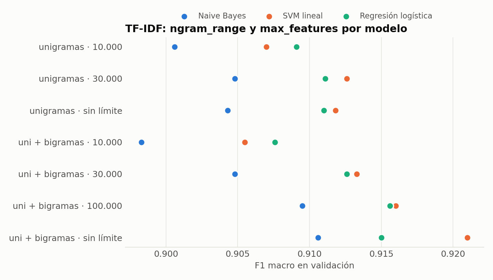
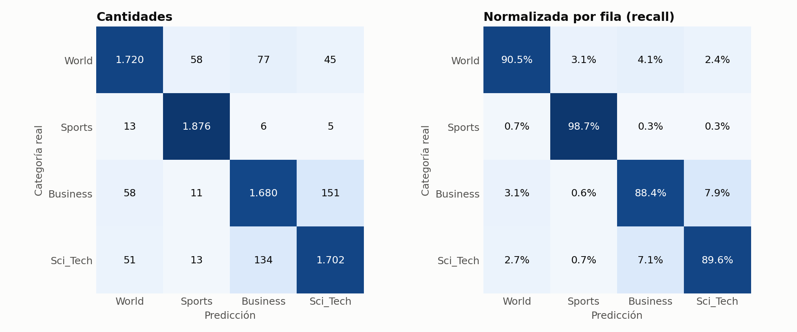
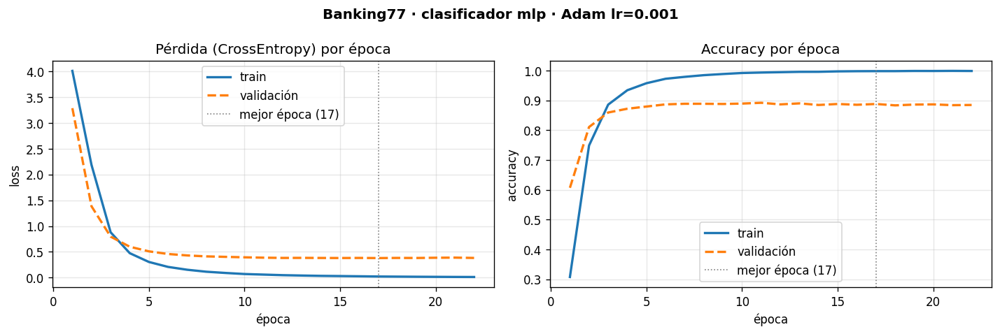

# Clasificación de noticias con NLP

[](https://colab.research.google.com/github/BaltaGalelli/ds3-proyecto-final/blob/main/notebooks/03_clasificador_tfidf.ipynb)

## Problema

Un medio, un agregador de noticias o un equipo de monitoreo recibe miles de artículos por día y necesita ordenarlos por tema para publicarlos en la sección correcta, recomendarlos o seguir un tema en particular. Este proyecto construye un modelo que **clasifica automáticamente cada noticia en su categoría** a partir del texto.

**Dataset:** [AG News](data/README.md)

## Pre-entrega 3: Clasificador supervisado con TF-IDF

### Pipeline

1. **Carga:** los splits oficiales de AG News (`ag_news_train.csv` y `ag_news_test.csv`). Ver [data/README.md](data/README.md).
2. **Preprocesamiento:**
   - Limpieza con regex: entidades HTML rotas, etiquetas, URLs, barras invertidas, tickers de bolsa y firmas de agencia;
   - Lematización con spaCy y minúsculas;
   - Stop-words fuera, conservando las negaciones;
   - Deduplicación: 120.000 → 118.388 noticias. Se sacaron 284 con etiquetas contradictorias, 1.166 duplicadas y 162 idénticas a una del test.
3. **Separación:** el test oficial (7.600) queda intacto hasta el final. Del train se separa un 10% estratificado como **validación** (106.549 de entrenamiento y 11.839 de validación).
4. **Vectorización:** `TfidfVectorizer` ajustado **solo con el entrenamiento** (`fit_transform`); a validación y test se les aplica `transform`. El modelo final es un `Pipeline` de scikit-learn, que lo garantiza solo.
5. **Modelado:** Naive Bayes multinomial, SVM lineal y Regresión Logística, cada uno con 7 configuraciones del vectorizador, más un ajuste de la regularización del ganador.
6. **Evaluación final:** La configuración ganadora se reentrena con todo el train y se evalúa **una sola vez** en el test: `classification_report` y matriz de confusión.

### Experimentos: `ngram_range` × `max_features` × modelo

F1 macro en validación (`min_df=2` en todos los casos):

| `ngram_range` | `max_features` | Términos | Memoria (MB) | Naive Bayes | Regresión logística | **SVM lineal** |
|---|---|---|---|---|---|---|
| (1, 1) | 10.000 | 10.000 | 24,7 | 0,9006 | 0,9084 | 0,9071 |
| (1, 1) | 30.000 | 30.000 | 26,3 | 0,9048 | 0,9110 | 0,9127 |
| (1, 1) | sin límite | 35.268 | 26,4 | 0,9044 | 0,9109 | 0,9122 |
| (1, 2) | 10.000 | 10.000 | 27,3 | 0,8981 | 0,9076 | 0,9051 |
| (1, 2) | 30.000 | 30.000 | 32,1 | 0,9048 | 0,9123 | 0,9129 |
| (1, 2) | 100.000 | 100.000 | 37,5 | 0,9094 | 0,9152 | 0,9156 |
| **(1, 2)** | **sin límite** | **347.597** | **44,8** | 0,9107 | 0,9151 | **0,9212** |



Regularización del SVM lineal con la mejor configuración: `C` = 0,1 → 0,9155 · 0,3 → 0,9198 · **1 → 0,9212** · 3 → 0,9159. Se queda el valor por defecto, `C=1`.

### Por qué SVM lineal

- **Es el mejor en validación:** 0,9212 de F1 macro, contra 0,9152 de la Regresión Logística y 0,9107 de Naive Bayes en sus mejores configuraciones. Gana en 5 de las 7 configuraciones del vectorizador.
- **Escala bien a muchos términos:** Con 347.597 términos y 106.549 noticias entrena en ~3 segundos. La Regresión Logística tarda ~17 segundos con la misma matriz y queda 0,6 puntos abajo.
- **Busca el margen máximo entre clases**, Lo que lo hace robusto cuando hay muchos más términos que los que aparecen en cada documento (el caso típico de texto).
- **Por qué no Naive Bayes:** Es el más rápido (menos de medio segundo), pero queda último en todas las configuraciones. Su supuesto de independencia entre palabras pesa más cuando se agregan bigramas, que están correlacionados con sus unigramas.
- **Lo que se resigna:** `LinearSVC` no da probabilidades. Si en el próximo módulo hacen falta (por ejemplo, para derivar solo las noticias con alta confianza), se pueden obtener con `CalibratedClassifierCV` o usar la Regresión Logística, que queda a 0,6 puntos.

### Parámetros del Vectorizador

| Parámetro | Valor | Por qué |
|---|---|---|
| `ngram_range` | `(1, 2)` | Captura expresiones de dos palabras con significado propio: *prime minister*, *red sox*, *oil price*, *open source*. Solo suma si se deja un vocabulario grande (ver tabla). |
| `max_features` | `None` | Limitar el vocabulario **no mejoró la generalización**: con 100.000 términos el F1 baja de 0,9212 a 0,9156, y con 10.000 a 0,9051. Los modelos lineales ya tienen regularización y `min_df` ya saca los términos únicos. Lo que sí da `max_features` es menos memoria (37,5 MB contra 44,8 MB con 100.000), y no hacía falta. |
| `min_df` | `2` | Saca los términos que aparecen en una sola noticia (errores de tipeo, nombres raros), que no generalizan. |
| `token_pattern`, `lowercase` | `r"\S+"`, `False` | El texto ya llega tokenizado y en minúsculas desde spaCy. Así se respetan sus tokens; el patrón por defecto de scikit-learn descartaría los de un carácter y los números de una cifra. |
| Stop-words | fuera, en el preprocesamiento | Con la lista de spaCy, conservando las negaciones: 347.597 términos en lugar de 382.252, y el F1 sube de 0,9180 a 0,9212. |
| `norm`, `sublinear_tf` | `"l2"`, `False` | Los valores por defecto. Con L2, todos los documentos tienen vector de largo 1, sin importar el largo de la noticia. |

### Texto crudo vs Limpio

Misma configuración (SVM lineal, uni + bigramas), cambiando solo la entrada:

| Entrada | Términos | F1 macro val |
|---|---|---|
| Texto crudo (sin limpiar) | 415.564 | **0,9281** |
| Solo limpieza regex (sin lematizar) | 407.843 | 0,9205 |
| Lemas con stop-words | 382.252 | 0,9180 |
| **Lemas sin stop-words (el elegido)** | **347.597** | 0,9212 |

**El texto crudo da el mejor número, pero por la razón equivocada.** La limpieza regex sola (sin lematizar) da casi lo mismo que los lemas, así que la ventaja no viene de "no lematizar", sino del ruido que la limpieza saca. Las **firmas de agencia delatan la categoría**:
- en el test, "(Sports Network)" aparece solo en Sports (78 de 78 noticias);
- "(SPACE.com)", "(PC World)" y "(Ziff Davis)" aparecen solo en Sci_Tech;
- "(AFP)" es World el 74% de las veces.

Un modelo entrenado con eso aprende a reconocer **la agencia, no el tema**, y con una noticia sin firma o de otra fuente el atajo no existe. Por eso me quedo con el texto limpio.

### Resultados en el Test

SVM lineal, `C=1`, TF-IDF de unigramas y bigramas, entrenado con las 118.388 noticias de train (383.918 términos):

| Categoría | Precision | Recall | F1 | Noticias |
|---|---|---|---|---|
| World | 0,9338 | 0,9053 | 0,9193 | 1.900 |
| Sports | 0,9581 | 0,9874 | **0,9725** | 1.900 |
| Business | 0,8861 | 0,8847 | **0,8854** | 1.900 |
| Sci_Tech | 0,8949 | 0,8963 | 0,8956 | 1.900 |
| **Total** | | **Accuracy 0,9184** | **F1 macro 0,9182** | 7.600 |

- **Sin sobreajuste a la validación:** F1 macro de 0,9212 en validación y 0,9182 en test, una diferencia de 0,3 puntos.
- **El resultado tiene sentido para el problema:** Con 4 clases balanceadas, adivinar al azar daría 25%. Los baselines publicados para AG News con bolsa de palabras rondan el 88-92% (Zhang et al., 2015), y los Transformers llegan a ~95%: este baseline está en el rango esperado y deja margen para el Módulo 4.

### Análisis preliminar: Qué categorías cuestan más?



| Real → Predicha | Errores | % de la categoría real |
|---|---|---|
| Business → Sci_Tech | 150 | 7,9% |
| Sci_Tech → Business | 133 | 7,0% |
| World → Business | 77 | 4,1% |
| World → Sports | 58 | 3,1% |
| Business → World | 58 | 3,1% |

- **Business y Sci_Tech son las más difíciles** (F1 de 0,885 y 0,896), y se confunden **entre sí**: son las dos confusiones más grandes, con 283 errores entre las dos (el 45% de todos los errores). Mirando los errores, son noticias **de negocios de empresas tecnológicas**: Intel que demora un producto, Yahoo que baja precios o Amazon que compra un competidor están etiquetadas como Business, mientras que IBM contratando gente o la salida a bolsa de Google están como Sci_Tech. Comparten vocabulario (*company*, *profit*, *software*, *web*) y la frontera es ambigua aun para una persona.
- **World pierde sobre todo contra Business** (4,1%: economía internacional, petróleo, sanciones) y **contra Sports** (3,1%): Las noticias de los Juegos Olímpicos de Atenas 2004 tienen contexto internacional.
- **Sports es la más fácil** (recall 98,7%): su vocabulario (*coach*, *quarterback*, *nascar*, *season*) casi no aparece en otras categorías.
- **Lo que mostraron los términos con más peso:**
  - Dos firmas de fuente que la limpieza de la Pre-entrega 2 no sacó: *cbs.mw* (CBS MarketWatch, 94% Business en el train) y *-washingtonpost.com* (Sci_Tech). Afectan a unas 55 noticias del test.
  - Ruido en las etiquetas: notas de la bolsa de Nueva York ("NEW YORK - Stocks rose...") etiquetadas como World.

### Limitaciones y próximos pasos

1. **Limpiar las firmas que quedaron** (*CBS.MW*, *washingtonpost.com*) y medir cuánto baja el F1 sin esos atajos.
2. **Embeddings y Transformers (Módulo 4):** TF-IDF no sabe que *profit* y *earnings* son parecidos ni entiende el contexto. Ahí está el margen para separar mejor Business de Sci_Tech.
3. **Sesgo temporal:** Las noticias son de 2004. Nombres como *arafat*, *enron* o *martha* (Stewart) pesan mucho, y con noticias actuales el modelo va a rendir menos.
4. **Probabilidades:** Calibrar el SVM si el caso de uso necesita un umbral de confianza.

## Pre-entrega 1:

Esta entrega construyó la **infraestructura** del proyecto con el dataset que había elegido entonces, [Banking77](data/README.md) (13.083 consultas bancarias, 77 motivos): un pipeline reproducible en PyTorch con detección automática del dispositivo, ciclo de entrenamiento explícito, validación por época, métricas y early stopping. El texto se representó con **TF-IDF** y el modelo fue un **MLP**.

| | |
|---|---|
| **Partición** | test oficial intacto (3.080); validación = 15% del train, estratificada (8.502 / 1.501) |
| **Representación** | TF-IDF de unigramas y bigramas, `min_df=2`, ajustado solo con train → 9.232 términos |
| **Modelo** | MLP `9.232 → 256 → 77` con ReLU y dropout 0.3 · baseline lineal `9.232 → 77` |
| **Entrenamiento** | `CrossEntropyLoss` + `Adam`, learning rate `0.001`, batch 64, hasta 30 épocas, early stopping (paciencia 5) |

| Modelo | Accuracy val. | Accuracy test | F1 macro test |
|---|---|---|---|
| Lineal (baseline) | 87.2% | 87.4% | 0.875 |
| **MLP** | **88.8%** | **89.8%** | **0.899** |



El learning rate se eligió probando 0.0001, 0.001 y 0.01 ([comparación](reports/figures/comparacion_learning_rate.png)). La curva muestra sobreajuste desde la época ~12: el early stopping corta en la 22 y se queda con los pesos de la 17. El detalle completo está en `notebooks/01_pipeline_base.ipynb`.

## Estructura del repositorio

```
ds3-proyecto-final/
├── data/                         # README con fuentes, licencias y hashes (los datos se descargan solos)
├── notebooks/
│   ├── 01_pipeline_base.ipynb       # Pre-entrega 1: pipeline en PyTorch (Banking77)
│   └── 03_clasificador_tfidf.ipynb  # Pre-entrega 3: clasificador TF-IDF sobre AG News (ejecutado)
├── src/pipeline/
│   ├── config.py                 # rutas e hiperparámetros
│   ├── preprocesamiento.py       # Pre-entrega 2: regex + spaCy + deduplicación
│   ├── ag_news.py                # carga de AG News (cátedra o pública verificada) y caché del corpus procesado
│   ├── clasico.py                # Pre-entrega 3: TF-IDF, modelos, experimentos, matriz de confusión
│   ├── datos.py, modelos.py, entrenamiento.py, entorno.py, reportes.py   # Pre-entrega 1 (PyTorch)
├── scripts/
│   ├── clasificador_tfidf.py     # Pre-entrega 3 completa por línea de comandos
│   └── entrenar.py               # Pre-entrega 1
├── tests/                        # 21 tests (pytest): preprocesamiento, fuga de datos, modelos
├── reports/                      # métricas (JSON/CSV) y figuras de cada entrega
├── requirements.txt
└── README.md
```

## Cómo ejecutarlo

**Google Colab:** botón *Open in Colab* → *Entorno de ejecución → Ejecutar todas*. La primera celda clona el repositori, por lo que no hace falta instalar nada. La primera corrida tarda unos 8 minutos, casi todo por la lematización con spaCy.

**Local:**

```bash
git clone https://github.com/BaltaGalelli/ds3-proyecto-final.git
cd ds3-proyecto-final
python -m venv .venv && source .venv/bin/activate     # Windows: .venv\Scripts\activate
pip install -r requirements.txt

python scripts/clasificador_tfidf.py      # Pre-entrega 3: experimentos, modelo final y evaluación en test
python scripts/entrenar.py                # Pre-entrega 1: MLP sobre Banking77
pytest                                    # tests
```

Para usar los CSV de la cátedra, copiá `ag_news_train.csv` y `ag_news_test.csv` en `data/ag_news/`. 

**Versiones:** Python 3.13, scikit-learn 1.9.1, spaCy 3.8.18 (`en_core_web_sm` 3.8.0), pandas 3.0.5, NumPy 2.5.3, matplotlib 3.11.2, PyTorch 2.15.0. El detalle está en [requirements.txt](requirements.txt).

## Decisiones de diseño

- **Sin fuga de datos:**
  - El TF-IDF se ajusta solo con el train, y el modelo final es un `Pipeline` de scikit-learn;
  - Las configuraciones se comparan en validación y el test se usa una sola vez;
  - La deduplicación toca solo el train.
  - Un test (`test_sin_fuga_el_vocabulario_sale_solo_del_train`) verifica que predecir no agregue palabras al vocabulario.
- **Preprocesamiento reutilizado, no reescrito:** Las funciones de la Pre-entrega 2 están en `src/pipeline/preprocesamiento.py` y el resultado se guarda en caché.
- **Matrices esparsas:** El TF-IDF nunca se convierte a denso. Con 347.597 términos, la matriz de entrenamiento ocupa 44,8 MB; en denso serían cientos de GB.
- **F1 macro como métrica de selección:** Las clases están balanceadas, así que da casi igual que la accuracy, pero pesa por igual a las 4 categorías y no esconde una clase mala.
- **Datos verificados:** Las descargas están fijadas a un commit y se verifican con SHA-256.
